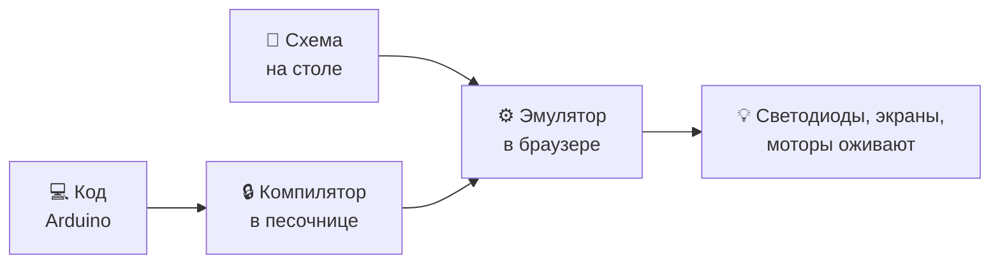

  

  
  
  

**Arduino Simulator** — учебная лаборатория прямо в браузере. Соберите схему на виртуальной макетной плате, напишите настоящий код Arduino и посмотрите, как она повела бы себя в жизни. Ничего не нужно покупать, устанавливать или бояться сжечь.

## ✨ Что внутри

- 🔌 **Редактор схем** — детали встают в отверстия макетной платы, провода тянутся мышью или пальцем
- 🧩 **Семь плат** — Arduino Uno, Nano, Mega, Raspberry Pi Pico, ESP32-S3, Raspberry Pi 4 и 5
- 💻 **Настоящий код** — скетч компилирует `arduino-cli`, а микроконтроллер эмулируется такт в такт; на Raspberry Pi 4/5 — Python прямо в браузере
- ⚡ **Честная физика** — светодиод без резистора сгорает, `5V` на `GND` даёт короткое замыкание
- 🧰 **Десятки деталей** — дисплеи, датчики, сервоприводы, моторы, клавиатуры, NeoPixel
- 📈 **Приборы** — монитор порта, мультиметр и график сигналов
- 🚀 **Готовые примеры** — по 50 для каждой платы, от мигающего светодиода до метеостанции

## 🏗 Как это работает

Симуляция целиком идёт в вашем браузере. Сервер нужен только для одного: превратить ваш код в прошивку.

## 🤖 Как это сделано

Проект написан с помощью **Claude Fable 5.2** — модели Anthropic — в Claude Code: от редактора схем и эмуляции до сервера компиляции и этой страницы.

Здесь лежит только собранная версия сайта. Она обновляется при каждой публикации.

